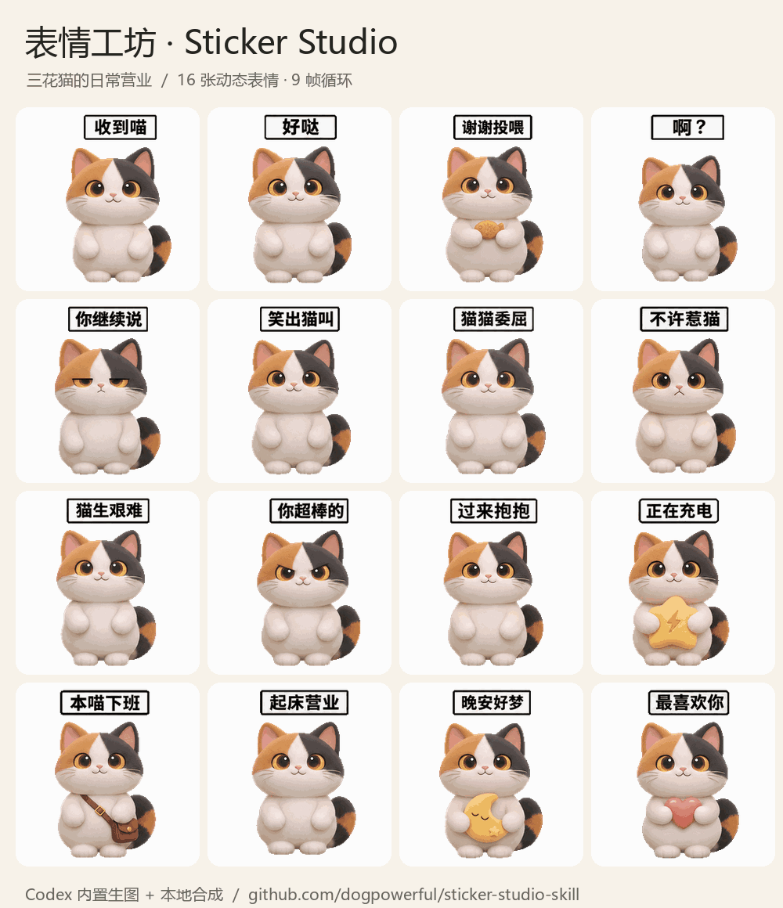

# 表情工坊 · Sticker Studio

用于 Codex 的动态表情包制作 skill：先确认角色基底与 16 张动作配字，再用 Codex 内置生图生成九帧分镜，完成透明 GIF、角色横向对齐、素材打包和检查。



上图由实际产出的 16 张 GIF 同步合成，展示「三花猫的日常营业」。宣传总览采用实色背景，原始单张表情为透明背景。[静态总览](docs/media/calico-overview.png) · [宣传封面](docs/media/cover.png)

## 安装与使用

将本仓库文件放入 Codex 的 `skills/sticker-studio/` 目录，确保 `SKILL.md` 位于该目录根部。

可直接克隆（目标目录不存在时）：

```sh
git clone https://github.com/homxuwang/sticker-studio-skill.git ~/.codex/skills/sticker-studio
```

Windows PowerShell：

```powershell
git clone https://github.com/homxuwang/sticker-studio-skill.git "$env:USERPROFILE\.codex\skills\sticker-studio"
```

已有安装先确认本地修改再更新；若当前会话没有发现 skill，可在新会话中调用。

示例：

```text
使用 $sticker-studio，做一套16张动态表情包。
角色是一只三花猫，先给我角色基底和动作配字表确认。
```

默认使用当前可用的 Codex 内置生图工具；不需要第三方模型、API key 或 OpenAI SDK。脚本只做本地处理，需 Python 3.10+ 和 Pillow。图片生成本身需要会话中可用的生图工具。

方案确认后可输入「确认，先生成第 1 张并提取 anchor，再完成其余 15 张，保留提示词和源图，检查并打包」。流程为：方案确认 → 第 1 张分镜 → 提取角色 anchor → 补齐分镜 → 封面与横幅 → 固定文字牌与躯干对齐 → 合成 GIF → 校验与视觉检查。

中断后可说「继续这套，复用 anchor 和合格源图」。局部修复可说「第 4 张耳尖被截断，请单独修复，保留旧版重新打包」。已有角色应提供参考图核对身份。

## 实际效果

三花猫示例覆盖收到、好的、谢谢、疑问、无语、哈哈、委屈、生气、裂开、加油、抱抱、摸鱼、下班、早安、晚安和爱你。单张 GIF 为 240×240、九帧、120ms/帧、无限循环，约 92–114KB；已完成技术校验及全部 144 帧静态检查。实时播放验收尚未完成，未提交平台审核。

角色参考能约束外观，不能保证绝对一致。躯干对齐只校正横向平移；手脚、道具、歪头、尺度和首尾接缝仍需检查。白色文字牌必须与耳尖、头饰分离，避免提取时截断角色；错字或身份漂移应定向修复源图。

打包器技术配置为：240px 透明 GIF、9 帧、至少 6px 留白、≤500KB；120px 缩略图、240px 封面、50px 图标、750×400 横幅。配置通过不代表平台实时规则或审核结论。

## 本地脚本

```sh
python -m pip install Pillow
python scripts/sticker_pipeline.py anchor --sheet /path/to/sheets/01.png --out /path/to/anchor.png
python scripts/sticker_pipeline.py build --manifest /path/to/album.json --out /path/to/album-v1
python scripts/sticker_pipeline.py validate --out /path/to/album-v1/wechat_upload
python scripts/sticker_pipeline.py qa --out /path/to/album-v1/wechat_upload --dest /path/to/album-v1/qa
```

输入格式见 [manifest 说明](references/manifest.md)，生成约束见 [生图说明](references/generation.md)。修复使用新版本目录，保留旧图及生成记录。

产物包括 16 张透明九帧 GIF、缩略图、封面、图标、横幅、预览 HTML、技术校验报告及 ZIP。保留现有 `wechat_upload` 目录名以兼容打包器。

自动校验和逐帧检查不能替代实时播放验收；躯干对齐是启发式处理，仍需查看完整循环。技术配置通过不代表平台审核通过。

`build` 拒绝覆盖已有目录，修改后请使用 `album-v2`。`qa` 从最终 GIF 导出深浅底九帧检查图，并创建待填写的 `review_status.json`；它不会自动判定画面质量。打开 `preview.html` 观察完整循环，分别记录技术校验、逐帧、播放和平台审核状态。

## 制作整套宣传总览

```sh
python scripts/create_showcase.py --album /path/to/album-v1/wechat_upload --dest /path/to/showcase --font /path/to/chinese-font.ttf
```

提供支持中文的字体，例如 Windows 的 `C:/Windows/Fonts/msyh.ttc`。脚本要求 16 张 GIF 均为九帧、帧时长一致，输出 `calico-overview.gif`、静态总览和封面。总览不替代单张透明素材。

[X 配文](docs/x-post.md) · [公众号配文](docs/wechat-article.md)

## 验证脚本

```sh
python scripts/test_pipeline.py
```
