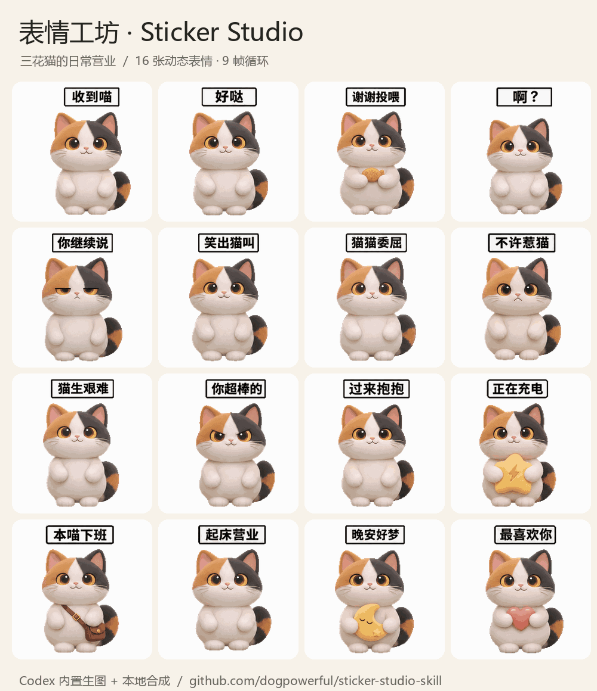

# 我把三花猫做成了 16 张动态表情，也把制作流程整理成了一个 Skill

摘要：从角色设定、动作配字，到九帧分镜、透明 GIF 和素材打包，用 Codex 跑完一套动态表情制作流程。



「收到喵」「你继续说」「猫猫委屈」「本喵下班」……这只三花猫现在有了一整套聊天表情。

做完之后，我把这次的流程和踩过的坑整理成了一个可复用的 Codex skill，叫「表情工坊」，英文名 Sticker Studio。

## 从一个角色，到一整套表情

它先帮你设计英文角色基底，以及 16 张表情的含义、中文配字和循环动作。先看方案，再决定是否开始生成。

确认后，先生成第 1 张九帧分镜，从中提取 anchor 角色参考图。后续图片以它为身份参考，分别表达疑问、生气、抱抱等动作，避免把同一张笑脸反复换字。

图片由 Codex 会话中的内置生图工具生成；拆帧、对齐、GIF 编码和打包交给本地 Python 脚本。默认不需要另接第三方模型或填写 API key。

## 真正花时间的是生成之后

把九宫格等宽切开，并不代表动画就稳定了。挥手和道具会改变整个角色的外接框，如果跟着外接框居中，身体就可能左右晃。

所以这套流程用躯干位置校正横向位移，并固定复用一张核对过的中文文字牌，减少文字摇摆。

另一个具体的坑，是歪头时耳尖离文字牌太近。源图看起来完整，合成提取时却可能误伤耳尖。这次的「啊？」就单独重做了一版，拉开间距后重新打包。这个检查点也写进了 skill。

## 最后会拿到什么

16 张透明九帧 GIF，以及缩略图、封面、图标、横幅、预览页、校验报告和 ZIP。提示词、源图与 anchor 也会保留，方便修改和中断续跑。

本次三花猫单张为 240×240，约 92–114KB，已通过脚本技术校验，并逐帧检查了 144 帧。开头的动态总览将 16 张实际产出放在同一张 GIF 里，方便看整套风格。

边界也要说清楚：参考图不能保证角色绝对一致，自动对齐不能保证所有部位完全不晃，静态逐帧检查不能代替实际播放。本次实时播放验收尚未完成，也未提交平台审核。

## 怎么开始

安装仓库到 Codex 的个人 skill 目录后，输入：

```text
使用 $sticker-studio，做一套16张动态表情包。
角色是一只三花猫，先给我角色基底和动作配字表确认。
```

想换角色，可以描述一只有性格的小动物、一个原创吉祥物，或者提供已有角色参考图。先确认人设和动作表，再开始生成。

项目地址：https://github.com/dogpowerful/sticker-studio-skill

完整安装方法、脚本命令和输入格式都在 README 里。如果你也想给自己的角色做一套动态表情，可以从这里开始。

---

配图与排版：封面用 `media/cover.png`，开篇用动态总览，文末可插入静态总览 `media/calico-overview.png`。粘贴到公众号编辑器后需单独上传图片，Markdown 路径不会自动成为平台素材。本文为待发布草稿。
